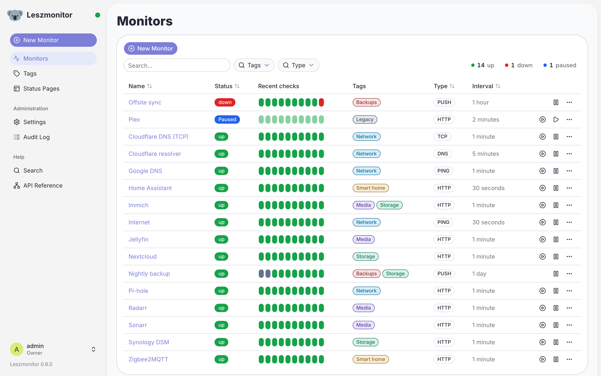
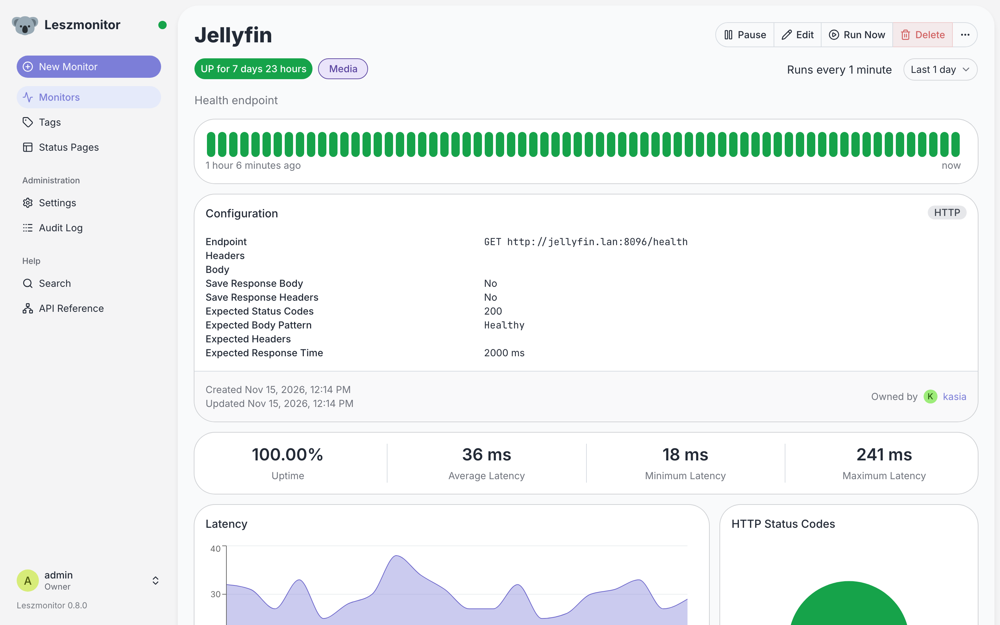
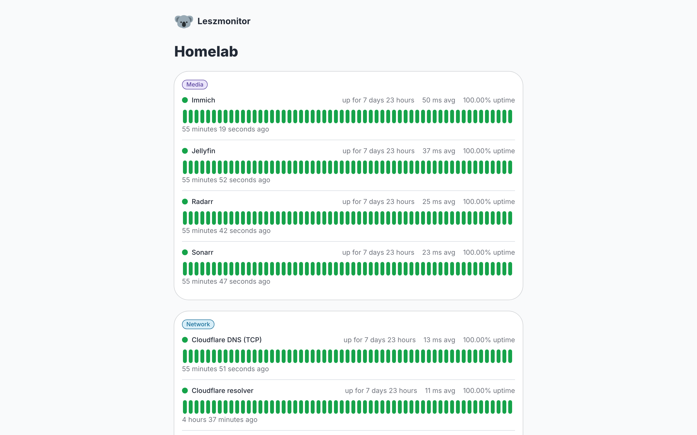
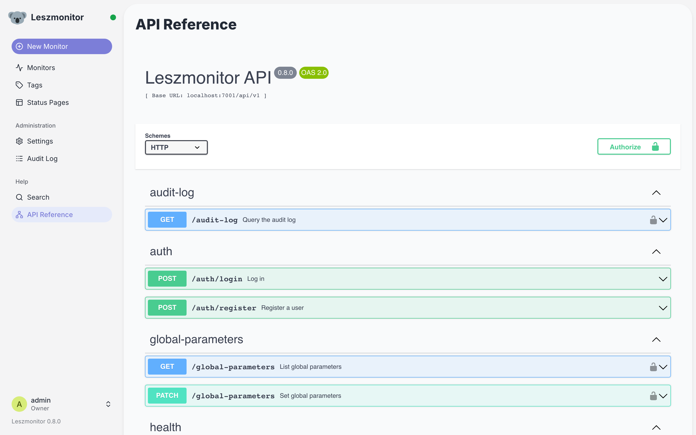

<div align="center">

<h1 style="margin: 0;">Leszmonitor</h1>
</div>
<div align="center">
 <strong>
   Lightweight homelab monitoring
 </strong>
<br/>
</div>

<div align="center">
  <br/>
    


  <br/>
</div>

<br/>

<picture>
  <source media="(prefers-color-scheme: dark)" srcset=".github/assets/screenshots/monitors-dark.png">
  
</picture>

Leszmonitor is a self-hosted uptime monitor for homelabs. It checks your services on a schedule and sends a
notification when one goes down.

## Features

- HTTP, TCP, ping, DNS and push checks
- Notifications through ntfy, Gotify or a webhook
- Status pages, public or behind a login, built from tags
- Monitors, tags, notification channels and status pages can be defined in a YAML file
- Multiple users with roles, and an audit log
- REST API, with docs in the UI
- Docker image for amd64 and arm64, rootless and built from `scratch`

## Quick start

Create a `docker-compose.yml`:

```yaml
services:
  leszmonitor:
    container_name: leszmonitor
    image: ghcr.io/m-milek/leszmonitor:latest
    ports:
      - "7001:7001"
    environment:
      SQLITE_DB_PATH: /data/leszmonitor.db
      JWT_SECRET: ${JWT_SECRET}
      INSTANCE_ADMIN_USERNAME: ${INSTANCE_ADMIN_USERNAME}
      INSTANCE_ADMIN_PASSWORD: ${INSTANCE_ADMIN_PASSWORD}
    volumes:
      - leszmonitor-data:/data
    restart: unless-stopped

volumes:
  leszmonitor-data:
```

And a `.env` next to it:

```env
JWT_SECRET=some-long-random-string
INSTANCE_ADMIN_USERNAME=admin
INSTANCE_ADMIN_PASSWORD=change-me
```

Then run `docker compose up -d` and open http://localhost:7001.

## Config file

You can define things in a YAML file instead of the UI. They show up in the UI as read-only, and the file is read
again on every start.

```yaml
tags:
  media:
    colorHex: "#8b5cf6"

notification_channels:
  phone:
    kind: ntfy
    config:
      serverUrl: https://ntfy.sh
      topic: my-homelab-alerts

monitors:
  jellyfin:
    name: Jellyfin
    type: http
    interval: 60
    tags: [ media ]
    notificationChannels: [ phone ]
    probeConfig:
      method: GET
      url: http://jellyfin.lan:8096/health
      expectedStatusCodes: [ 200 ]

  router:
    name: Router
    type: ping
    interval: 30
    notificationChannels: [ phone ]
    probeConfig:
      host: 192.168.1.1
      count: 3
      timeoutMs: 2000

status_pages:
  home:
    title: Homelab
    description: ""
    groupMonitorsByTag: true
    requireAuth: false
    enabled: true
    timeWindowSeconds: 86400
    tags: [ media ]
```

Mount it into the container and point `CONFIG_FILE_PATH` at it:

```yaml
    environment:
      CONFIG_FILE_PATH: /config.yaml
    volumes:
      - ./config.yaml:/config.yaml:ro
```

Secrets in notification channel config can come from environment variables, e.g. `token: ${NTFY_TOKEN}`.

## Environment variables

| Variable                  | Required | Default            | Description                                 |
|---------------------------|----------|--------------------|---------------------------------------------|
| `JWT_SECRET`              | yes      |                    | Secret used to sign login tokens            |
| `INSTANCE_ADMIN_USERNAME` | yes      |                    | Admin account created on first start        |
| `INSTANCE_ADMIN_PASSWORD` | yes      |                    | Password for that account                   |
| `API_PORT`                | no       | `7001`             | Port for the web UI and API                 |
| `SQLITE_DB_PATH`          | no       | `./leszmonitor.db` | Where the database is stored                |
| `JWT_EXPIRY_HOURS`        | no       | `24`               | How long a login lasts                      |
| `CONFIG_FILE_PATH`        | no       |                    | Path to a config file                       |
| `LOG_LEVEL`               | no       | `INFO`             | `TRACE`, `DEBUG`, `INFO`, `WARN` or `ERROR` |
| `LOG_FORMAT`              | no       | `CONSOLE`          | `CONSOLE` or `JSON`                         |

## Data and backups

All data lives in one SQLite file.

- Mount a directory (like `/data` above), not the `.db` file itself. SQLite keeps extra files next to it.
- Don't put it on a network share (NFS, SMB).
- Run one Leszmonitor per database.
- To back up, stop the container and copy the file, or use `sqlite3 leszmonitor.db ".backup backup.db"` while it
  runs. Don't copy the file while Leszmonitor is running.

## Updating

```bash
docker compose pull
docker compose up -d
```

## Screenshots

<table>
  <tr>
    <td>
      <picture>
        <source media="(prefers-color-scheme: dark)" srcset=".github/assets/screenshots/monitor-http-dark.png">
        
      </picture>
    </td>
    <td>
      <picture>
        <source media="(prefers-color-scheme: dark)" srcset=".github/assets/screenshots/status-page-public-dark.png">
        
      </picture>
    </td>
  </tr>
  <tr>
    <td align="center">Monitor details</td>
    <td align="center">Status page</td>
  </tr>
  <tr>
    <td>
      <picture>
        <source media="(prefers-color-scheme: dark)" srcset=".github/assets/screenshots/api-reference-dark.png">
        
      </picture>
    </td>
    <td></td>
  </tr>
  <tr>
    <td align="center">API reference</td>
    <td></td>
  </tr>
</table>

## Development

The project uses [Task](https://taskfile.dev/). Run `task --list` to see what's available, and `task dev` to start
the server and UI with live reload.
